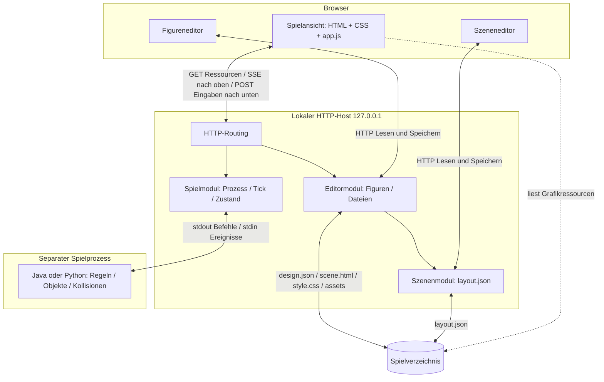
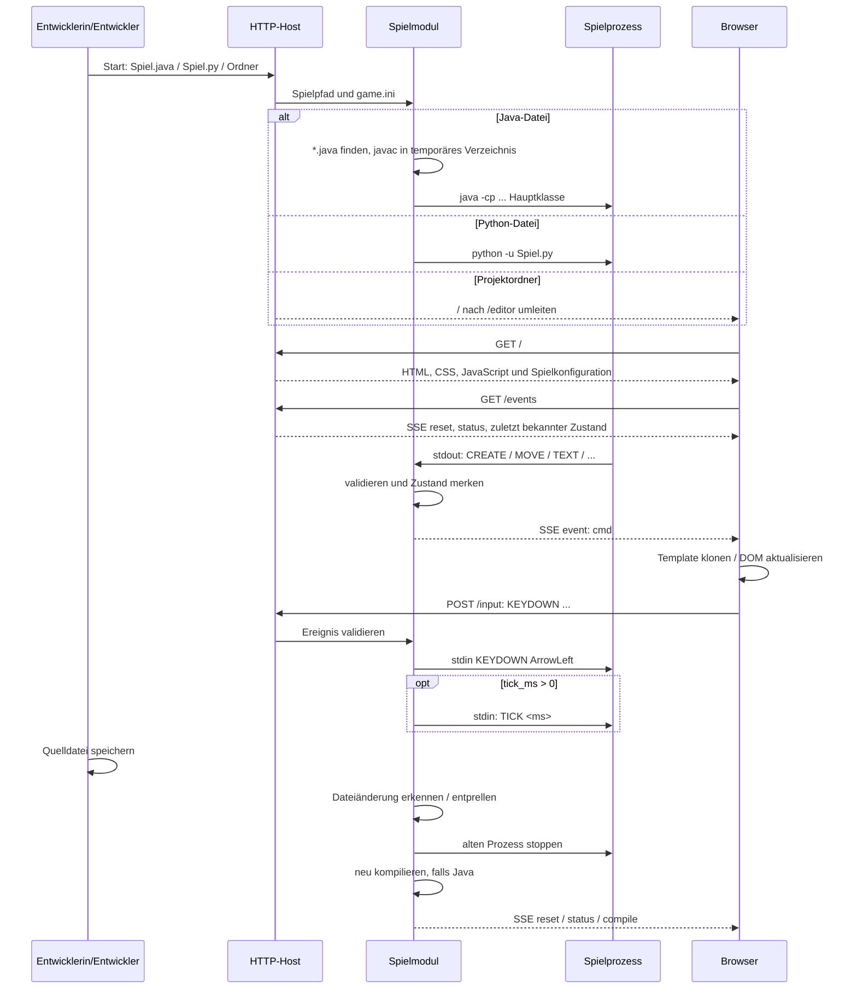
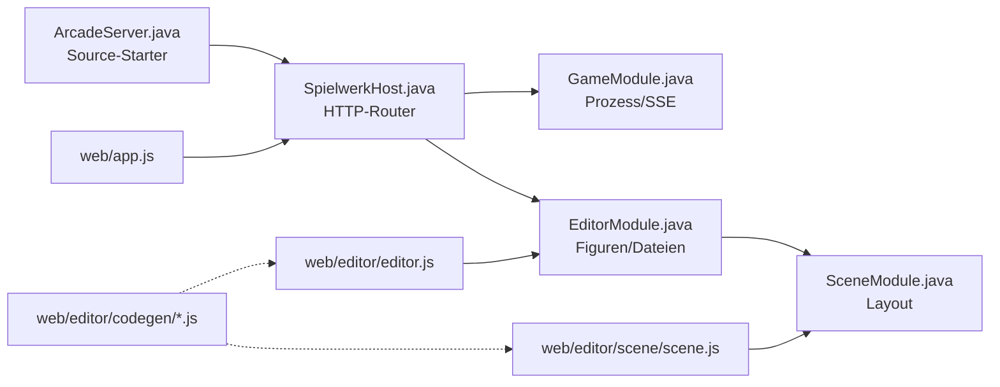

# Spielwerk – Konzept, Herkunft und Architektur

**Entwicklerhandbuch · Stand: November 2026 · Zielgruppe:** Menschen, die Spielwerk verstehen, warten oder erweitern möchten.

> **Leitidee:** Ein normales Konsolenprogramm soll mit sehr wenigen Textzeilen sichtbare, interaktive Spiele im Browser steuern können. HTML und CSS stellen die Grafik dar; `stdout` transportiert Darstellungsbefehle, `stdin` liefert Ereignisse zurück. Die Spielregeln bleiben im Programm.

Dieses Dokument ist der Einstieg in die **Entwicklerdokumentation**. Ergänzend gehören dazu:

- [Schnittstellen und Datenformate](SCHNITTSTELLEN-UND-DATEN.md): Spielprotokoll, HTTP/SSE, Werkstatt-APIs, JSON und Dateiformate.
- [Quellcode, Tests und Erweiterungen](CODE-UND-ENTWICKLUNG.md): Landkarte des Repositories, Kontrollfluss, Entwicklungspfade, Prüfungen und Fehlersuche.
- [Studierendenhandbuch](HANDBUCH.md), [Protokollreferenz](PROTOKOLL.md), [Figureneditor](SPIELWERKSTATT.md) und [Szeneneditor](SZENENEDITOR.md): die Anwendersicht.

Die Beschreibung beruht auf den Server- und Browserdateien einschließlich Figuren- und Szeneneditor sowie den nachfolgenden Korrekturen für Startskripte und optionale Ressourcen. Sie dokumentiert **implementiertes Verhalten**, nicht ein geplantes universelles Spieleframework. Bei künftigen Änderungen müssen insbesondere die Tabellen der Schnittstellen mit dem Quellcode abgeglichen werden.

---

## 1. Warum es Spielwerk gibt

Spielwerk entstand aus einer didaktischen Frage im Bachelor-Modul *Programmieren 1*: Wie können Studierende im ersten Semester in **gewöhnlichem Java** Figuren bewegen, Spiele entwickeln und die unmittelbare Rückmeldung einer grafischen Ausgabe erleben, ohne vorher eine große GUI-Bibliothek lernen zu müssen?

Anfangs standen Arcade-Spiele als Motivation im Vordergrund. Wichtig war von Anfang an, dass die Umgebung **keinen eigenen Anwendungsstil erzwingt**: keine obligatorische Basisklasse, keine Vererbung von einer Game-Engine und kein Paket mit vielen abstrakten Grafikobjekten. Das Programm darf Klassen, Variablen, Schleifen, Methoden und Datenstrukturen so verwenden, wie es im Unterricht sinnvoll ist. Ein zusätzliches Framework soll diese Lerninhalte nicht überdecken.

Die Wurzeln der Idee liegen auch bei [Live View Programming](https://github.com/denkspuren/LiveViewProgramming): Dort werden mediale Inhalte mittels eines sprachunabhängigen Textprotokolls aus gewöhnlichen Programmen im Browser sichtbar. Spielwerk konzentriert dieses Prinzip auf **kleine interaktive Spiele** und ergänzt eine sehr schmale Ereignis-Rückrichtung. Die konzeptionellen Anforderungen und Gestaltungsentscheidungen wurden im Austausch zur Lehre entwickelt; die erste Softwareumsetzung und Dokumentation wurden mit ChatGPT erarbeitet. Spielwerk beansprucht **nicht**, stdin/stdout, DOM-Grafik oder Hot Reload erfunden zu haben.

Aus dem ersten Spielserver entstanden schrittweise zwei weitere Werkzeuge: ein **Figureneditor** für HTML/CSS-Vorlagen und ein **Szeneneditor** für ihre räumliche Anordnung. Der programmierdidaktische Kern ist dabei unverändert geblieben.

### Die sechs Leitentscheidungen

1. **Radikal HTML/CSS:** Das sichtbare Spiel besteht aus normalen DOM-Elementen, HTML-Templates, CSS-Regeln, Bildern und Audioelementen; nicht aus einem eigenen Canvas-Zeichenmodell. JavaScript ist ein kleiner Darstellungs- und Ereignisadapter.
2. **Kleines Sprachprotokoll:** Spielprogramme geben zeilenweise Befehle auf `stdout` aus und lesen zeilenweise Ereignisse von `stdin`. Keine JSON-Abhängigkeit und keine Spielwerk-Bibliothek im Spielprogramm.
3. **Prozessisolation als Schnittstelle:** Jedes Spiel läuft als **eigener Betriebssystemprozess**. Der Webserver übersetzt lediglich zwischen Prozess-Ein-/Ausgabe und Browsertransport.
4. **Klare Verantwortung:** Die Spielregeln und Kollisionen gehören dem Spielprogramm; Anzeige und Eingabeerfassung dem Browser; Prozessstart und Vermittlung dem Server; Gestaltung und Ressourcenverwaltung der Werkstatt.
5. **Sprachneutraler Vertrag:** Die Befehle haben in Java und Python dieselbe Bedeutung. Lediglich das Starten/Kompilieren ist sprachabhängig. Die Werkstatt speichert sprachneutrale Daten.
6. **Einstieg ohne Projektkonfiguration:** Eine `.java`-Datei kompiliert und startet automatisch, eine `.py`-Datei startet direkt, und ein Verzeichnis öffnet nur die Werkstatt. Eine `game.ini` ist optional und enthält **keine** Build-Anweisungen.

### Bewusst *nicht* das Ziel

Spielwerk soll zunächst **keine** Physikengine, kein Animations-Timeline-System, kein allgemeiner Webseitengenerator und keine komplexe Deployment-Plattform sein. Das minimale System darf einfache Spiele ermöglichen, ohne den eigentlichen Lerngegenstand – die Programmierung – zu verdrängen.

---

## 2. Drei Welten, zwei Kommunikationsgrenzen



Die zwei Kommunikationsgrenzen sind absichtlich verschieden:

- **Spielprozess ↔ Server:** Zeilenprotokoll über `stdin`/`stdout`. Diese Schnittstelle ist für Anfänger, Übungen und weitere Programmiersprachen gedacht.
- **Server ↔ Browser:** HTTP zum Laden, HTTP-POST für Eingaben und **Server-Sent Events (SSE)** zum Übertragen laufender Zustands- und Darstellungsnachrichten. Diese Schnittstelle ist ein Implementierungsdetail der Laufzeitumgebung.

Die Werkstatt besitzt zusätzlich eine **eigene HTTP-API** zum Lesen und Speichern. Dort ist JSON sinnvoll: ein komplexer Figurenentwurf ist ein Dokument, kein Echtzeit-Spielkommando. Die oft verwendete Kurzform „Spielwerk benötigt kein JSON“ bezieht sich **ausschließlich auf das Spielprotokoll**, nicht auf die Werkstatt.

### Zuständigkeiten auf einen Blick

| Verantwortlichkeit | Komponente | Was sie ausdrücklich nicht tut |
|---|---|---|
| Spielregeln, Zustand, Kollisionen, Punktestand | Java-/Python-Spiel | HTML rendern, HTTP bedienen |
| Kompilieren, Starten, Neustarten, Tick-Takt, Weiterleitung | Spielmodul | Grafik gestalten, Kollisionen berechnen |
| HTTP-Routing und Ausliefern | Host/Webserver | Spielregeln implementieren |
| DOM-Objekte erzeugen, positionieren, ausblenden; Sounds | Spielansicht | Eigenständige Spielsimulation |
| Figuren entwerfen und HTML/CSS exportieren | Figureneditor / Editormodul | Spielquellen bearbeiten |
| Startpositionen und statische Szenerie festlegen | Szeneneditor / Szenenmodul | Dynamische Spielregeln übernehmen |
| Java-/Python-Kopiervorschläge | Sprachgeneratoren im Editor | Code automatisch einfügen oder aktualisieren |

**Wichtige Abhängigkeit:** Der Spielserver startet das Programm; er ruft keine Java-Methoden im Spiel auf. Der Editor steuert keine Spielprozesse. Ihre Verbindung besteht allein in den **Dateien der Vorlagen** und in den IDs, auf die das Spielprotokoll verweist.

---

## 3. Weshalb HTML und CSS überraschend viel leisten

Eine Spielfigur ist zunächst nur ein vorbereiteter HTML-Baustein:

```html
<template id="ball">
  <div class="ball"></div>
</template>
```

```css
.ball {
  width: 40px;
  height: 40px;
  border-radius: 50%;
  background: radial-gradient(circle at 30% 25%, #d9f7ff, #2798d4 65%, #114c83);
  box-shadow: 0 0 14px #38bdf8aa;
}
```

Das `<template>` ist zunächst **unsichtbar** und dient als Bauplan. Trifft `CREATE ball1 ball` ein, klont `web/app.js` dessen erstes Wurzelelement, vergibt `id="ball1"` und fügt es ins Spielfeld ein. `MOVE ball1 120 90` ändert nur eine CSS-Transformation, nicht das HTML der Vorlage:

```css
transform: translate3d(120px, 90px, 0);
```

CSS erzeugt bereits mit `border-radius`, Verläufen, Schatten, Rahmen, `clip-path` und Masken sehr unterschiedliche Formen. Eine Figur kann aus mehreren absolut positionierten Kind-Elementen bestehen. Bilder (`SVG`, `PNG` usw.) und Audio sind ebenso möglich. Der Browser erledigt Layout und Darstellung; das Spielprogramm berechnet lediglich neue Koordinaten.

**Es gibt dennoch Grenzen:** Sehr viele bewegte DOM-Elemente, komplexe Effekte oder aufwendige physikalische Simulationen sind nicht das Ziel. Bewegung findet hier durch wiederholte Positionsänderung statt, nicht durch eine allgemeine Szenengraph- oder Grafikengine.

### Koordinaten, Größen und Kollisionen

Der Ursprung `(0,0)` liegt links oben im Spielfeld. X wächst nach rechts, Y nach unten. Maße sind **CSS-Pixel**; `MOVE` erwartet ganze Zahlen.

Die sichtbare Größe eines Templates wird in HTML/CSS bzw. im Entwurf des Figureneditors festgelegt. Das Spielprotokoll besitzt bewusst keinen `GET_SIZE`-Befehl. Die Spiellogik hält bekannte Breiten und Höhen (oder vom Editor **kopierte** Konstanten) vor. Für eine achsenparallele Rechteckkollision gilt:

```text
A.x < B.x + B.w   und   A.x + A.w > B.x
A.y < B.y + B.h   und   A.y + A.h > B.y
```

Der Figureneditor verwaltet zusätzlich einen **separaten relativen Kollisionskasten** (`hit.x`, `hit.y`, `hit.w`, `hit.h`). Liegt die Figur bei `(X,Y)`, beginnt ihre Kollisionsfläche bei `(X + hit.x, Y + hit.y)`. Drehungen, Spiegelungen, Schatten oder transparente Bildteile verändern diese Kollisionsfläche **nicht automatisch**: Sie ist ein bewusst gesetztes, achsenparalleles Rechteck.

---

## 4. Lebenszyklus eines Spiels



Die Server überwachen die **obersten** `.java`- bzw. `.py`-Dateien des Spielverzeichnisses. Die aktuelle Implementierung prüft ungefähr alle 100 ms und entprellt Änderungen etwa 350 ms lang. Java-Dateien werden gemeinsam kompiliert; Python wird ohne Kompilierung mit ungepufferter Ausgabe (`-u`) ausgeführt. Ein Java-Compilerfehler erzeugt den Status `COMPILE_ERROR` samt Diagnose im Browser. Eine erneute Dateispeicherung löst einen neuen Versuch aus.

**Nicht überwacht werden:** `game.ini`, die normalen HTML-/CSS-Dateien und die Werkstattdaten. Die Grafik wird nach einem manuellen Neuladen des Browsers aktualisiert; Konfigurationsänderungen erfordern einen Neustart des Servers. Diese Unterscheidung ist wichtig, wenn man die Oberfläche verändert und keine Wirkung sieht.

### Blockierende Eingabe ist beabsichtigt

```java
try (var in = new java.io.BufferedReader(
        new java.io.InputStreamReader(System.in, java.nio.charset.StandardCharsets.UTF_8))) {
    String event;
    while ((event = in.readLine()) != null) {
        if (event.equals("KEYDOWN ArrowRight")) {
            System.out.println("MOVE held 140 100");
        }
    }
}
```

`readLine()` wartet ohne CPU-intensive Schleife, bis der Server ein Ereignis bereitstellt. Tastaturereignisse und optionale Ticks landen **in demselben Eingabestrom**. Das Spiel benötigt daher keinen eigenen Eingabe- oder Timerthread. In Python funktioniert dieselbe Idee mit `for line in sys.stdin:` und `print(..., flush=True)`.

### Ereignisgesteuert oder zeitgesteuert?

- **Ereignisgesteuert (`tick_ms = 0`):** Nur Tasten- und Mausereignisse führen zu Aktionen. Gut für Schiebepuzzles, Rasterspiele und Menüs.
- **Zeitgesteuert (`tick_ms > 0`):** Zusätzlich kommen `TICK n`-Zeilen. Geeignet für Bewegung, Gravitation, Geschosse und Gegner. Der Server lässt Ticks bei Überlast aus; es besteht kein Anspruch auf exakt verstrichene Echtzeit.

Es handelt sich bewusst um eine **einzige sequentielle Ereignisverarbeitung im Spiel**. Die internen Serverthreads gehören zur Infrastruktur und sollten nicht mit studentischer Nebenläufigkeit verwechselt werden.

---

## 5. Aufbau des Spielverzeichnisses

```text
games/mein_spiel/
├── MeinSpiel.java            # ODER MeinSpiel.py; eigenständiger Spielprozess
├── game.ini                  # optional: Titel, Spielfeldgröße, Ticks
├── scene.html                # handgeschriebene HTML-Templates, Texte, Audio
├── style.css                 # handgeschriebene Darstellung
├── assets/                   # Bilder und Audio, falls vorhanden
└── spielwerk/                # optional; ausschließlich Werkstatt-Ausgaben
    ├── design.json          # editierbarer Figurenentwurf
    ├── scene.html           # generierte HTML-Templates der Figuren
    ├── style.css            # generiertes CSS der Figuren
    └── layout.json          # Szenenobjekte und ihre Positionen
```

Die Namen sind absichtlich einfach. `scene.html` in der Wurzel und `spielwerk/scene.html` haben **verschiedene Eigentümer**. Der Figureneditor überschreibt niemals die handgeschriebene Szene; der Szeneneditor schreibt **nur** `layout.json`. Die Werkstatt-Dateien sind optional; Space Invaders und andere selbst geschriebene Spiele funktionieren ohne sie. Der HTML-Host bindet vorhandene Werkstattressourcen optional ein und vermeidet bei fehlenden Dateien unnötige 404-Anfragen.

Die ursprünglichen Spielvorlagen sowie die Werkstatt-Templates landen gemeinsam im DOM der Spielansicht. **Template-IDs müssen deshalb eindeutig sein.** Analog dürfen statische Szenenobjekte und vom Programm erzeugte Objekte keine widersprüchlichen IDs erhalten.

### Optionale `game.ini`

```ini
[game]
title = Mein erstes Spiel
width = 640
height = 480
tick_ms = 0
```

Zulässig sind Breite und Höhe zwischen **200 und 2048** Pixeln sowie `tick_ms = 0` oder **mindestens 15**. Ohne Datei gelten 640 × 480 Pixel und `tick_ms = 0`. Die `game.ini` enthält **keine** Sprache, Compiler- oder Startkommandos. Die Hauptdatei wird beim Serverstart direkt angegeben.

---

## 6. Die Spielwerkstatt: getrennt, aber kompatibel

### 6.1 Figureneditor (`/editor`)

Der Figureneditor verarbeitet sprachneutrale Entwürfe aus Rechtecken, Ellipsen, Dreiecken, Kreisbögen, Texten und Bildern. Die Ebenen können verschoben, gedreht und horizontal oder vertikal gespiegelt werden. Rastereinrastung, Mittelachsen, Zoom und Kollisionsrechteck unterstützen das Gestalten.

**Die Quelle der Wahrheit ist `spielwerk/design.json`.** Die Editoransicht erzeugt daraus HTML-Templates und CSS. Die Dateien `spielwerk/scene.html` und `spielwerk/style.css` sind **generierte Ergebnisse**, die bei erneutem Speichern ersetzt werden. Manuelle Nachbearbeitung dieser Dateien wäre daher nicht dauerhaft. Statische Grafiken dürfen hingegen weiterhin in der handgeschriebenen Szene angelegt werden.

Die Vorschau nutzt denselben CSS-Stilgenerator wie der Export. Dreiecke entstehen durch `clip-path: polygon(...)`, Kreisbögen durch einen `conic-gradient` und eine ringförmige CSS-Maske, Drehung und Spiegelung über `transform`. Der Spielprozess muss davon **nichts wissen**.

### 6.2 Szeneneditor (`/editor/scene`)

Der Szeneneditor liest vorhandene Templates aus beiden Szenenquellen und speichert nur ein sprachneutrales `spielwerk/layout.json` mit Objekt-ID, Template-ID, Koordinaten und Modus:

- **`static`:** Die Browser-Spielansicht klont das Template **automatisch beim Laden**; es ist von Anfang an Bestandteil der Szene.
- **`dynamic`:** Der Eintrag dient **nur als Planung** im Editor. Das Spielprogramm muss ihn mittels `CREATE`, `MOVE` und ggf. `SHOW` selbst erzeugen. Eine Editorposition ist keine automatische Startposition des Programms.

Die Szenenvorschau verwendet einen eigenen **Shadow DOM** als CSS-Abgrenzung. So kann sie echte Spiel-CSS-Regeln zur Vorschau laden, ohne das restliche Editorlayout mit diesen Regeln zu vermischen. Eine Änderung an `layout.json` wird nach einem Neuladen der Spielansicht sichtbar.

Der Szeneneditor ist kein weiterer Spielprozess und sendet keine `MOVE`-Befehle an ein laufendes Spiel.

### 6.3 Codevorschläge sind ausdrücklich nur lesend

Die Java- und Python-Generatoren liegen unter `web/editor/codegen/` und erhalten eine **Kopie** des Entwurfs bzw. der Szene. Sie erzeugen etwa Konstanten für Abmessungen/Kollisionen oder eine Sequenz von `CREATE`-/`MOVE`-/`SHOW`-Anweisungen. Nutzerinnen und Nutzer können diese **kopieren**. Kein Modul schreibt in `.java`- oder `.py`-Dateien; es gibt dafür bewusst keinen HTTP-Endpunkt.

Eine neue Sprache bedeutet **nicht** automatisch einen neuen Spielserver: Ein neuer Generator liefert lediglich passende Codevorschläge. Soll die Sprache als ausführbares Spiel unterstützt werden, benötigt das Spielmodul zusätzlich einen Prozessstarter, der denselben Textvertrag einhält.

---

## 7. Modulgrenzen in der Implementierung



Der Java-Starter `ArcadeServer.java` kompiliert die Servermodule mit dem **JDK-Compiler in ein temporäres Verzeichnis** und startet `SpielwerkHost` in einem eigenen Java-Prozess. Dafür braucht das Projekt weder Maven noch Gradle. Der Host benutzt `com.sun.net.httpserver.HttpServer` (Bestandteil des JDK).

Die alternative Python-Implementierung hat die gleiche funktionale Trennung, aber einen anderen Zuschnitt: `server.py` enthält HTTP-Host und Spielverwaltung, `editor_module.py` den Figuren-/Dateiteil, `scene_module.py` das Szenenmodell. **Gleiche Schnittstelle** bedeutet nicht identische interne Klassenstruktur.

Die vollständigen Pfade, Zustandsklassen, Funktionsnamen und ein Einstieg für Änderungen stehen im [Codewegweiser](CODE-UND-ENTWICKLUNG.md).

---

## 8. Architekturregeln für Weiterentwicklungen

Bei jedem Feature lohnt es sich, diese Fragen zu beantworten:

1. **Ist es Spielverhalten?** Dann gehört es in das Spielprogramm oder – falls wirklich allgemein – ins klar versionierte Textprotokoll. Der Browser soll keine versteckten Regeln entwickeln.
2. **Ist es Darstellung?** Dann gehören Templates und CSS in die Ressourcen, die Interpretation von Displaybefehlen in `web/app.js`.
3. **Ist es Prozess- oder Transportlogik?** Dann ins Spielmodul bzw. den HTTP-Host, mit identischen öffentlich beobachtbaren Verhaltensweisen beider Server.
4. **Ist es eine Gestaltungsfunktion?** Dann in den Figuren- oder Szeneneditor und seine Datei-API, nicht ins Spielmodul.
5. **Ist es sprachspezifischer Beispielcode?** Dann in einen eigenständigen Codegenerator, der keine Dateien verändert.
6. **Braucht es wirklich eine neue Konfiguration?** Wenn eine Dateiendung oder die vorhandene `game.ini` genügt, sollte keine neue Build-/Projektkonfiguration hinzukommen.

**Stabilitätsregel:** Änderungen am Spielprotokoll sind besonders folgenreich: Validatoren beider Server, Darstellung in `web/app.js`, Tests, Lernbeispiele und Dokumentation müssen gemeinsam aktualisiert werden. Neue Werkstatt-Features sollten, wenn möglich, **keinerlei Änderung am Spielprotokoll** erfordern.

---

## 9. Technische Grenzen und Sicherheitsmodell

Spielwerk ist derzeit eine **lokale Entwicklungsumgebung**, kein öffentlich erreichbarer Mehrbenutzer-Gameserver.

- Beide Server binden an **`127.0.0.1`**. Die Werkstatt besitzt Datei-Schreibrechte im ausgewählten Projekt. Die Schreib-APIs prüfen u. a. Ursprung/Host und einen zusätzlichen Header; dies ersetzt **keine** Benutzerverwaltung für öffentliche Bereitstellung.
- Hochgeladene Bilder sind auf bestimmte Dateitypen und **2 MB** begrenzt. SVGs können als bestehende Ressourcen eingebunden werden, sind aber **kein** Bild-Uploadformat des Figureneditors.
- Server-zu-Browser-Transport verwendet SSE und HTTP-POST; es gibt keinen WebSocket-Server. Bei langsamen Clients oder Programmen können Nachrichten bzw. Ticks verloren gehen. Das ist für das Lehrszenario ein bewusster Kompromiss.
- `design.json` und `layout.json` sind editierbare Strukturdateien. Die vom Editor erzeugten HTML-/CSS-Dateien sind keine allgemeine Rückübersetzung beliebigen handgeschriebenen Codes.
- Ein Spielprozess wird **mit den Rechten der Person ausgeführt**, die den Server startet. Unbekannte Spielprogramme oder unbekannte HTML-/JS-Dateien dürfen nicht als vertrauenswürdig gelten. Es besteht keine Sandbox.
- Drehungen, Masken und Schatten sind Darstellungseffekte; die Spiellogik erhält keine automatische Geometrie oder Bildabtastung.

Eine ausführliche Darstellung der aktuellen Validierungsgrenzen, der Ressourcen-APIs und der nicht garantierten Eigenschaften folgt in [Schnittstellen und Datenformate](SCHNITTSTELLEN-UND-DATEN.md).

---

## 10. In welcher Reihenfolge sollte man den Code lesen?

1. **Ein Spiel:** [`games/sternenpfad/Sternenpfad.java`](../games/sternenpfad/Sternenpfad.java) oder [`games/balllabor/Balllabor.java`](../games/balllabor/Balllabor.java). Hier sieht man Ein- und Ausgabe ohne Infrastrukturdetails.
2. **Spielbrowser:** [`web/app.js`](../web/app.js), speziell `resetScene`, `applyCommand`, `send` und `start`.
3. **Spielprozess:** [`server-java/GameModule.java`](../server-java/GameModule.java), besonders `Manager`, `Session` und `Scene`.
4. **HTTP-Verbindung:** [`server-java/SpielwerkHost.java`](../server-java/SpielwerkHost.java), besonders `handle`, `page`, `post` und `events`.
5. **Figureneditor:** [`web/editor/editor.js`](../web/editor/editor.js) und [`server-java/EditorModule.java`](../server-java/EditorModule.java).
6. **Szeneneditor:** [`web/editor/scene/scene-model.js`](../web/editor/scene/scene-model.js), [`scene.js`](../web/editor/scene/scene.js) und [`server-java/SceneModule.java`](../server-java/SceneModule.java).
7. **Zweite Serverimplementierung:** [`server.py`](../server.py), [`editor_module.py`](../editor_module.py), [`scene_module.py`](../scene_module.py) als Vergleich der Verträge.

Zum gezielten Umsetzen und Testen einzelner Änderungen siehe den [Entwicklungswegweiser](CODE-UND-ENTWICKLUNG.md).
